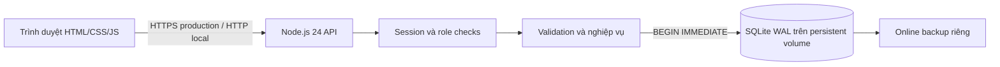
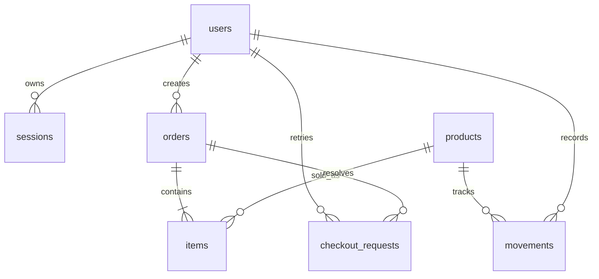

# Kiến trúc GiftShop 0.2.0

Schema thực: phần khởi tạo server.js. products.sku UNIQUE, price và stock không âm. items giữ snapshot tên/giá tại lúc bán. checkout_requests có PK(user_id, request_key). Không đổi runtime Node thành static Pages; SQLite cần volume, không tự chạy nhiều instance dùng file khác nhau.

## Hợp đồng API chính
- POST /api/login: username/password → cookie và username/role.
- GET /api/me; POST /api/logout.
- POST /api/password: current_password/new_password → hủy mọi phiên cũ.
- GET/POST /api/products; PATCH/DELETE /api/products/:id (ghi chỉ admin).
- POST /api/stock: product_id, qty, note (admin); GET /api/movements (200 bản ghi gần nhất).
- GET/POST /api/orders (danh sách 200 gần nhất). POST cần header Idempotency-Key 16–100 ký tự và items[{product_id,qty}].
- GET /api/orders/:id trả chi tiết snapshot.
- POST /api/orders/:id/cancel (admin): hoàn hàng và tái kích hoạt sản phẩm nếu đã archive.
- GET /api/stats (admin): doanh thu hợp lệ, đơn, sản phẩm, cảnh báo, 30 ngày giao dịch gần nhất, top5.
- GET/POST /api/users (admin): danh sách chỉ trả id/username/role; tạo user mới với password 12–256 ký tự.

HTTP: 400 đầu vào sai/nghiệp vụ không hợp lệ; 401 chưa đăng nhập; 403 sai quyền/Origin; 404 không thấy; 409 mã trùng/idempotency conflict; 413 body quá lớn; 429 giới hạn đăng nhập; 500 lỗi hệ thống. Error response là {error:string}.

## Giới hạn bản nhỏ
Không phân trang lịch sử quá 200 bản ghi trên UI; không lợi nhuận/giá vốn; chưa có quên mật khẩu; rate-limit theo socket trong RAM; chưa thử tải production; browser QA và UAT còn chờ. Các giới hạn này phải được người nghiệm thu chấp nhận hoặc đưa vào backlog thay đổi.
