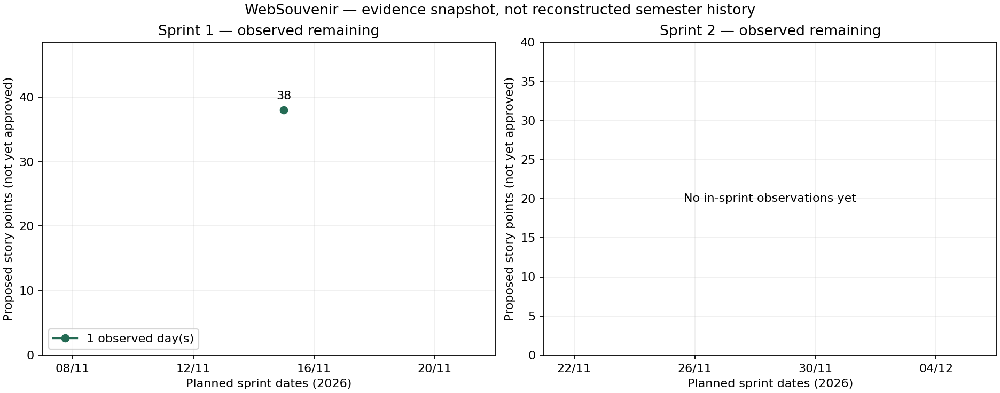

# Bộ công việc PM — TanTai08

Chủ trì: TanTai08. Hồ sơ được Codex hỗ trợ chuẩn bị ngày 15/11/2026, chưa thay xác nhận của nhóm hoặc stakeholder. Họ tên/MSSV, môn kế thừa, deadline và stakeholder để trống theo yêu cầu PM.

## Kết quả có thể kiểm chứng

Nguồn quan sát: [EVIDENCE_SNAPSHOT.json](EVIDENCE_SNAPSHOT.json), Board lúc 2026-11-15T15:22:10.679Z; source commit 1b749bbd7d4315cb3f8d7b6bcbf36112b5ead187. Có 20 Issue, 5 assignee theo vai trò; Backlog 3, Ready 2, In Progress 13, In Review 2, Done 0. Điểm85 vẫn là đề xuất, chưa phải kết quả Planning Poker. Không suy ra phần trăm hoàn thành học kỳ từ số commit.

[PR #1](https://github.com/TanTai08/WebSouvenir/pull/1) đang mở; tại lúc chụp chưa có review, đã yêu cầu4 thành viên. Các check verify/browser/container của bản được quan sát đều SUCCESS. Có 19 test Node (13 app/cấu hình +6 merge gate),8 Chromium case và Docker volume smoke. Chưa có URL production/UAT được xác nhận trong hồ sơ.

## Sáu nhiệm vụ PM

| Nhiệm vụ | Đầu ra đã chuẩn bị | Điều kiện còn chờ |
|---|---|---|
| GS01 / #2 | Charter, đội hình5 vai trò, scope/AC, danh sách stakeholder cần xác nhận | Thông tin thật, người nghiệm thu đồng ý và chữ ký |
| GS02 / #3 | Phiếu10 câu hỏi, scope in/out và bảng xác nhận nhu cầu | Phỏng vấn thật, ghi kết quả và xác nhận phạm vi |
| GS10 / #11 | Agenda Review/Retro, quan sát kỹ thuật có nguồn, action đề xuất, kế hoạch Sprint 2 | Họp thật, người tham gia, quyết định và cam kết Sprint |
| GS15 / #16 | CR-001 hosting miễn phí, phân tích tác động, risk thực tế và decision log | CCB/stakeholder duyệt giới hạn, cập nhật đúng Week 11 |
| GS19 / #20 |5 nhóm báo cáo, báo cáo7 chương/15 trang, evidence index và WBS Dictionary 20 gói | Evidence học kỳ, peer approval, nghiệm thu và rà soát cuối |
| GS20 / #21 | Slide 10 trang, speaker notes, runbook 6+5+5 phút và checklist demo dự phòng | Diễn tập thật, ghi thời lượng/lỗi và điều chỉnh |

## Tài liệu sử dụng

- [Phạm vi và tiêu chí nghiệm thu](SCOPE_ACCEPTANCE_DRAFT.md)
- [Phiếu phỏng vấn và xác nhận stakeholder](STAKEHOLDER_INTERVIEW_DRAFT.md)
- [Review/Retro Sprint 1](SPRINT1_REVIEW_RETRO_DRAFT.md)
- [Kế hoạch Sprint 2 đề xuất](SPRINT2_PLAN_PROPOSED.md)
- [Kiểm soát rủi ro/thay đổi](RISK_CHANGE_CONTROL.md)
- [Chỉ mục5 nhóm báo cáo](EVIDENCE_INDEX.md)
- [Kịch bản bảo vệ và diễn tập](DEFENSE_RUNBOOK.md)
- [Nội dung10 slide](DEFENSE_SLIDES_DRAFT.md)
- [WBS Dictionary 20 gói](WBS_DICTIONARY.csv)

## Việc PM cần xác nhận sau

Môn kế thừa: __________. Hạn nộp: __________. Người nghiệm thu/đơn vị: __________.
Họ tên và MSSV của5 người: điền config/team.json; đóng góp thực tế cần cả nhóm thống nhất, tổng100%.
Xác nhận Charter và WBS bằng chữ ký hoặc nguồn trao đổi được phép sử dụng; không dùng checklist do trợ lý chuẩn bị thay cho xác nhận.

## Burndown theo quan sát thật

[CSV nguồn](BURNDOWN_OBSERVED.csv) và [biểu đồ PDF](../../reports/Burndown_Observed_Current.pdf). Sprint 1 mới có một ngày đo; Sprint 2 chưa bắt đầu nên chưa có điểm thực thi để vẽ. Các điểm vẫn là ước lượng đề xuất; biểu đồ này chưa thay lịch sử hai Sprint.

